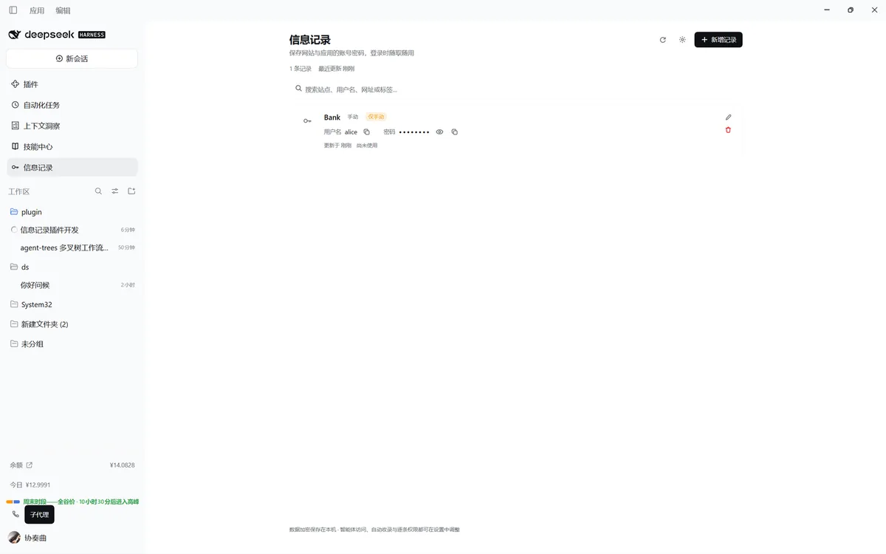
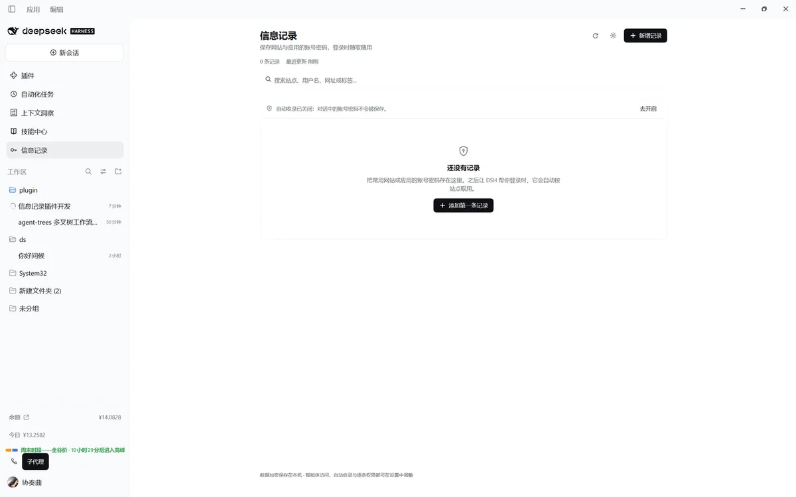
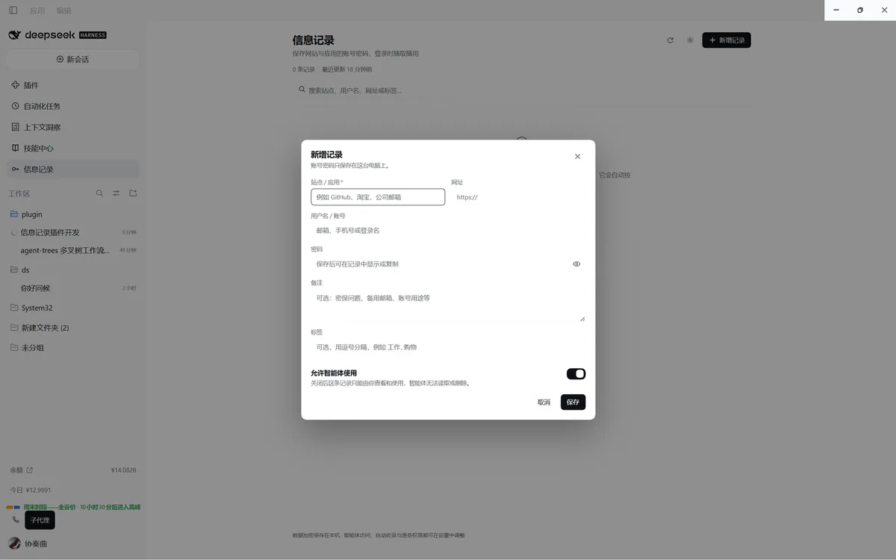
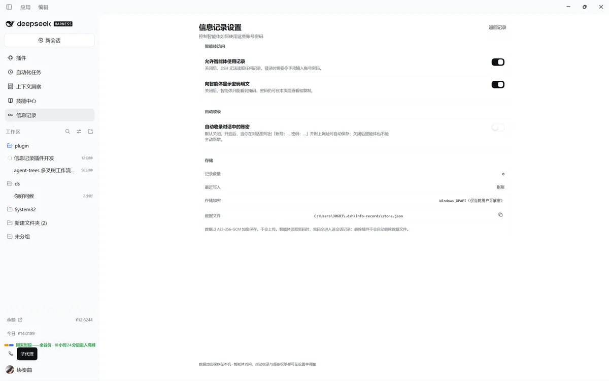

# 信息记录 · dsh-info-records

**为 DeepSeek Harness 准备的本机加密账密库：你维护记录，智能体在登录前按站点取用。**

> **English at a glance** — An encrypted, local-first credential vault for
> DeepSeek Harness. Manage website/app logins in a native sidebar panel; the
> `info_records` tool lets the agent look up the right account before signing in.
> Capturing credentials from chat is **opt-in**, every record can be marked
> **manual-only**, and the vault is AES-256-GCM encrypted with the data key kept
> in Windows DPAPI, the macOS Keychain, or the Linux Secret Service. Requires
> DSH ≥ 0.2.1-rc.2 and Node ≥ 22.19.



## 它解决什么问题

用 DSH 打开网页、登录后台、处理工单时，账号密码常常要重复输入；把密码直接发进对话，又会留在会话记录里。

信息记录把账号密码集中保存在本机，并按站点组织：

- 你可以在侧边栏 **技能中心 → 信息记录** 里新增、编辑、搜索、删除记录；
- 智能体在登录前调用 `info_records` 工具，按站点/网址取用正确的账号密码；
- 你可以在对话里明确给出「账号：… 密码：…」，让插件自动收录（**默认关闭，需手动开启**）；
- 每条记录都可以标记为 **仅手动使用**：智能体既读不到、也改不了、删不掉。

## 功能

### 记录管理

- 站点/应用、网址、用户名、密码、备注、标签。
- 搜索站点、网址、用户名、备注与标签。
- 密码默认掩码，逐条显示/复制；用户名一键复制；网址一键打开。
- 删除有就地二次确认；显示使用次数、最近更新与来源（手动 / 自动 / 智能体）。
- 支持深色/浅色主题，跟随 DSH 的 `--dsw-alias-*` 设计令牌。

### 智能体工具 `info_records`

| action | 行为 |
| --- | --- |
| `list` | 列出记录（站点、用户名、标签、id；**不返回密码**） |
| `search` | 按站点/网址/用户名/标签/备注搜索（**不返回密码**） |
| `get` | 按 id / 站点 / 网址取完整记录；返回密码（可被设置关闭）；自动标记「已使用」 |
| `save` | 新增或合并记录（需要开启自动收录） |
| `delete` | 按 id 删除，或删除唯一的站点匹配 |
| `used` | 补记一次使用 |

工具描述会要求模型：登录前先 `get`、不要向无关工具转发密码、除非用户明确要求否则不要在回复里打印密码。

### 自动收录（默认关闭）

开启后，当一条用户消息同时包含「账号/用户名…」和「密码/口令…」以及网址时，自动保存或合并成一条记录，来源标记为「自动」。同一消息只处理一次；关闭后智能体的 `save` 也会被拒绝。

> 默认关闭是有意的：密码进入对话本身就是一个需要用户明确同意的动作。
> 记录页会在关闭时显示提示与一键开启入口。



### 逐条权限

每条记录有一个 **允许智能体使用** 开关（默认开）。关闭后：

- `get`、`save` 覆盖、`delete`、`used` 全部拒绝；
- `list`/`search` 只显示站点、用户名等元数据，并标记「仅手动」，备注也不返回；
- 你自己仍然可以在面板里查看、复制、编辑、删除。



## 安装

### 插件市场（推荐）

DSH 的插件目录来自 [awesome-dsh-plugin](https://github.com/awesome-dsh-plugin/awesome-dsh-plugin)。在 **设置 → 插件市场** 搜索「信息记录」或 `dsh-info-records` 即可安装；尚未上架时可用下面的 npm 方式。

### npm

```sh
dsh plugin --profile web add dsh-info-records
```

`web` 换成你自己的 profile 名；官方 Desktop 版请在应用内的 **设置 → 插件** 中安装。

### 本地目录

```sh
dsh plugin --profile web add /absolute/path/to/info-records
```

安装后打开任意会话，侧边栏 **技能中心** 下方会出现 **信息记录**。

## 快速上手

1. 打开 **信息记录 → 新增记录**，填入站点、用户名、密码，按需加网址/备注/标签。
2. 让 DSH 帮你登录时，它会调用 `info_records` 取用；你可以要求它「登录前先查信息记录」。
3. 想自动收录时，在 **设置 → 自动收录** 打开开关；不想让智能体碰的记录，编辑时关闭 **允许智能体使用**。

## 安全模型

### 加密存储

- 数据文件使用 **AES-256-GCM** 加密，随机 256 位数据密钥只用于本机。
- 数据密钥的保护方式（设置页会显示当前方式）：
  - **Windows DPAPI（CurrentUser）**：密钥包裹后存进文档，只有当前 Windows 用户能解开。
  - **macOS 钥匙串**：通过 `security` 写入/读取登录钥匙串。
  - **Linux Secret Service**：通过 `secret-tool` 使用系统密钥环。
  - **本地密钥文件（回退）**：`vault.key`，权限 0600；这是弱回退，设置页会给出警告。
- 旧版 v1 明文文档会在首次读取时自动迁移为 v2 加密文档，明文被原子替换。
- 密钥保护只调用系统自带命令（`powershell.exe`、`security`、`secret-tool`），参数仅包含随机密钥或包裹后的密钥，不含用户输入；失败信息不会回显密钥。
- 解密失败、密钥指纹不匹配或文件损坏时，**不会覆盖原文件**；损坏文件会另存为 `store.json.corrupt-<timestamp>`。
- 原子写入（临时文件 + rename），写入串行化；POSIX 上目录 0700、文件 0600。

### 诚实的边界

- **同一 OS 用户下的进程仍可解密**：智能体自己的 shell 以你的账户运行，也能调用同一个系统密钥接口。加密保护的是「文件被复制/备份/其他用户读取/磁盘被翻看」，不是「账户已被攻破」。
- **DPAPI/钥匙串绑定了用户与机器**：把 `store.json` 单独拷到另一台电脑或另一个 Windows 用户，通常无法解密。当前版本还没有便携备份/导出，迁移前请先在旧机器上手动抄录或等待后续版本。若使用本地密钥文件回退，复制整个 `info-records` 目录（含 `vault.key`）可以迁移，但保护也更弱。
- **`get` 的密码会进入该会话记录**：这是让模型代替你输入的代价。设置里的「向智能体显示密码明文」可以关闭，让智能体只看到掩码。
- **自动收录是显式选项**：默认关闭；开启后，带标签的账密会被保存，普通提及登录页不会触发。
- **不是硬件密码库**：没有主密码、硬件密钥或防内存取证能力。高价值账号建议继续使用专用密码管理器。

### 网络面

- 浏览器只通过一个同源 POST 路由 `/api/info-records/rpc` 读写，注册在 `ctx.connection.fetch` 上，由 DSH 连接层负责浏览器认证。
- 没有遥测、没有外部请求、没有 CDN 资源；所有数据留在本机。
- 面板不读取其他插件的 DOM、样式或私有状态。

## 设置

| 设置 | 默认 | 作用 |
| --- | --- | --- |
| 允许智能体使用记录 | 开 | 关闭后 `info_records` 全部拒绝；逐条开关仍然生效 |
| 向智能体显示密码明文 | 开 | 关闭后 `get` 返回掩码，页面仍可显示/复制 |
| 自动收录对话中的账密 | **关** | 开启后才自动保存对话中的账密，也才允许智能体 `save` |

设置页同时显示记录数、最近写入、存储加密方式与数据文件路径（可复制）。同一组开关也注册在 **设置 → 信息记录**，不需要先找到侧边栏入口。



## 存储位置

```text
<DSH home>/info-records/store.json        # AES-256-GCM 密文
<DSH home>/info-records/vault.key         # 仅 fallback 方式出现
```

默认 DSH home 是 `~/.dsh`，也可由 `DSH_HOME` 指定。卸载插件不会删除数据文件。

## 兼容性

- 已在 **DSH 0.2.1-rc.2**（官方 Desktop）验证：侧边栏入口、主面板、设置页、`info_records` 工具、v1 → v2 加密迁移。
- 需要 Node.js **22.19+**。
- 插件是纯 JavaScript，无构建步骤、无运行时 npm 依赖。
- 使用 `sidebar.panellist` / `main` / `settings.section` 插槽与 `ctx.connection.fetch`、`ctx.tools`、`ctx.on` 等稳定扩展点。
- 加密回退与钥匙串路径做了跨平台实现；Windows DPAPI 已实测，macOS/Linux 的具体密钥环行为取决于系统策略（可能弹一次授权提示）。

## 已知限制

- 自动收录只识别带标签的账密（`账号：… 密码：…`，最多 3 组），不支持自由散文；其余情况可以让智能体 `save` 或手动添加。
- 没有便携导出/导入；DPAPI/钥匙串加密与当前用户、当前机器绑定。
- 没有主密码、二次验证或自动锁定。
- `list`/`search` 会向模型暴露站点、用户名等元数据（密码与仅手动记录的备注除外），这是让模型选对账号所需的最小信息。

## 开发

```text
index.js            宿主：路由、info_records 工具、自动收录、存储编排
vault.js            AES-256-GCM + DPAPI/Keychain/Secret Service/密钥文件
client.js           Web：侧边栏入口、记录页、设置页、编辑弹窗、中英文文案
cordis.patch.yml    插入 info-records 行
locale/*.json       插件管理器标题与描述
docs/screenshots/   README 截图
```

插件没有构建步骤：`index.js`、`vault.js`、`client.js` 直接加载。`client.js` 通过
`window.__ModuleLoader__.load({ id: 'dsh-info-records', ... })` 注册，React 来自浏览器
模块表。

## License

MIT。见 [LICENSE](LICENSE)。
